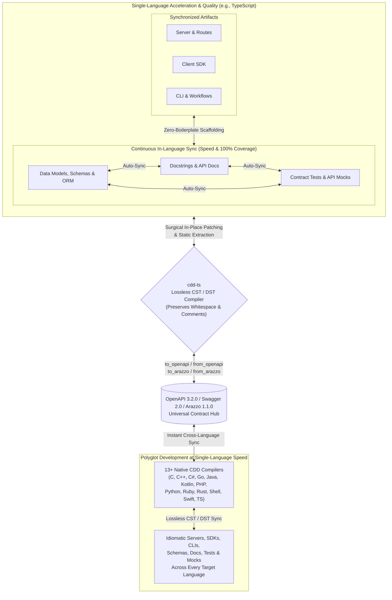

cdd-ts: TypeScript ⇄ OpenAPI
============================

[](https://opensource.org/licenses/Apache-2.0)
[](https://offscale.io/wasm_web_demo)
[](https://github.com/offscale/cdd-ts/actions)
[](#)
[](#)

**cdd-ts** compiles **[OpenAPI](https://spec.openapis.org/oas/latest.html) / [Swagger](https://spec.openapis.org/oas/v2.0.html) / [Arazzo](https://spec.openapis.org/arazzo/latest.html)** to and from **TypeScript** (servers, client SDKs, CLIs, database schemas, tests, mocks, and docs), updating your existing code in-place without overwriting your edits.

**Compiler Driven Development (CDD)** is a software engineering methodology that uses a suite of standalone, lossless compilers to synchronize API specifications, server implementations, client SDKs, command-line tooling, workflow orchestrators, tests, and documentation.

Unlike traditional code generators that treat outputs as disposable or read-only, Compiler Driven Development provides a **complete, standalone compiler** (exposed as both a CLI and a programmatic SDK) written natively in each supported language. Where conventional compilers rely solely on an Abstract Syntax Tree (AST) that discards formatting and comments, CDD compilers operate on a **Concrete Syntax Tree (CST)** or **Decorated Syntax Tree (DST)**. This guarantees **lossless conversion**—preserving exact whitespace, indentation, inline comments, block comments, and docstrings—allowing true bidirectional synchronization between hand-edited `TypeScript` source code and [OpenAPI 3.2.0](https://spec.openapis.org/oas/v3.2.0.html), [Swagger 2.0](https://spec.openapis.org/oas/v2.0.html), and [Arazzo 1.1.0](https://spec.openapis.org/arazzo/v1.1.0.html) specifications.

---

## Why Compiler Driven Development?

By replacing one-way templates and manual boilerplate with lossless CST/DST compilers, Compiler Driven Development transforms the engineering lifecycle across four dimensions:

- **Development Speed**: Eliminate manual boilerplate across servers, client SDKs, CLIs, database models, workflow runners, and mock servers. Start from an [OpenAPI](https://spec.openapis.org/oas/latest.html) or [Arazzo](https://spec.openapis.org/arazzo/latest.html) specification to scaffold an entire installable project (complete with package manifests and CI workflows), or write code first in `TypeScript` and extract the specification automatically. When requirements change, update whichever representation is most convenient and synchronize the rest immediately.
- **Development Consistency**: Every data model, route handler, CLI flag, ORM entity, workflow step, and API contract is derived from and validated against the same semantic representation. Architectural drift between backend routes, frontend clients, and published specifications becomes structurally impossible.
- **Development Quality**: Keeping tests and documentation in lockstep with implementation code is automated rather than an afterthought. Because the compiler parses and emits docstrings, type signatures, API mocks, and contract test suites alongside your business logic, maintaining **100% documentation coverage and 100% test coverage** becomes a natural byproduct of compilation rather than a manual chore.
- **Polyglot Development**: Seamlessly bridge **13+ programming languages** (C, C++, C#, Go, Java, Kotlin, PHP, Python, Ruby, Rust, POSIX Shell, Swift, and TypeScript) to and from [OpenAPI](https://spec.openapis.org/oas/latest.html) and [Arazzo](https://spec.openapis.org/arazzo/latest.html) specifications. Any codebase in any supported language can be reverse-compiled into OpenAPI/Arazzo and immediately compiled forward into idiomatic, human-editable code across every other language in the suite. And being an open-source methodology—rather than a proprietary trade secret—new languages can be added by implementing new compilers that follow the CDD approach (see [cdd-spec-conformance](https://github.com/SamuelMarks/cdd-spec-conformance) for tooling to facilitate).

---

## The Standalone Compiler Architecture and Lossless Conversion

Traditional code generation tools rely on destructive templating: if you regenerate your project from an updated specification, your custom implementation logic, formatting, and comments are overwritten.

Each Compiler Driven Development toolchain is written natively in its target language, compiles both to native binaries and to **WebAssembly (WASM/WASI)**, and implements a full lexer, parser, semantic differ, and code emitter backed by Concrete Syntax Tree (CST) and Decorated Syntax Tree (DST) representations:

- **Beyond AST to CST/DST**: A standard Abstract Syntax Tree (AST) captures program semantics while stripping away "trivia" (whitespace, blank lines, and comments). By pairing structural AST semantics with a Concrete Syntax Tree (CST) or Decorated Syntax Tree (DST) that attaches trivia and structured documentation directly to syntax nodes, the compiler preserves 100% of your source formatting and comments.
- **Zero-Destruction Guarantee**: Every part of the generated codebase is designed to be edited by humans. You can open generated routing files, data models, database entities, workflow runners, tests, and CLI commands, format them to your preferences, add inline comments, and inject custom business logic.
- **When your specification changes**: The CDD compiler parses your existing source files into a CST/DST, computes a semantic diff against the updated [OpenAPI](https://spec.openapis.org/oas/latest.html) or [Arazzo](https://spec.openapis.org/arazzo/latest.html) specification, and surgically patches in new endpoints, workflows, parameters, or fields without disturbing your custom logic, comments, or whitespace.
- **When your codebase changes**: The compiler statically analyzes your updated source code, routes, workflows, tests, and docstrings—without unsafe dynamic code execution or reflection—to extract a 100% compliant, authoritative [OpenAPI](https://spec.openapis.org/oas/latest.html) or [Arazzo](https://spec.openapis.org/arazzo/latest.html) specification.

---

## The Bidirectional Synchronization Loop



The Compiler Driven Development lifecycle delivers compounding returns in both single-language and polyglot environments:
1. **Single-Language Speed**: Edit whichever artifact is most convenient—models/schemas, route handlers, docstrings, or tests—and let `cdd-ts` surgically synchronize the rest in-place without overwriting your custom logic, comments, or whitespace.
2. **Single-Language Quality**: Because schemas, documentation, contract tests, and mocks are continuously cross-compiled rather than manually maintained, **100% doc coverage and 100% test coverage** are enforced automatically on every sync.
3. **Polyglot Development at Single-Language Speed**: Extracting an authoritative [OpenAPI](https://spec.openapis.org/oas/latest.html) or [Arazzo](https://spec.openapis.org/arazzo/latest.html) contract from one language immediately drives lossless forward-compilation across all 13+ supported languages—making multi-language SDK, CLI, and service maintenance just as fast as working in a single codebase.

---

## Core Capabilities Shared Across All CDD Compilers

Every `cdd-*` repository in the suite implements the same foundational feature set:

- **Bidirectional OpenAPI 3.2.0 & Swagger 2.0 Compilation**:
  - `from_openapi`: Generate idiomatic `TypeScript` Client SDKs (`to_sdk`), Client CLIs (`to_sdk_cli`), and Server stubs/routers (`to_server`) from a single specification (`-i`) or a batch directory of specifications (`--input-dir`). Automatically upgrades legacy Swagger 2.0 and OpenAPI 3.0/3.1 specifications to OpenAPI 3.2.0.
  - `to_openapi`: Statically parse existing `TypeScript` source files or directories to extract a compliant OpenAPI 3.2.0 specification.
- **Bidirectional Arazzo 1.1.0 Workflow Orchestration**:
  - `from_arazzo`: Compile multi-step [Arazzo 1.1.0](https://spec.openapis.org/arazzo/v1.1.0.html) workflow specifications (including runtime expressions, step DAGs, criterion evaluations, and failure/success actions) into `TypeScript` SDK workflow orchestrators (`to_sdk`), CLI workflow runners (`to_sdk_cli`), and Server/E2E workflow test suites (`to_server`).
  - `to_arazzo`: Reverse-parse `TypeScript` workflow orchestrators, CLI scripts, or E2E test suites back into an authoritative Arazzo 1.1.0 document.
- **In-Place Codebase Synchronization (`sync`)**:
  - Synchronize data models, ORM schemas, route handlers, docstrings, contract tests, mocks, and specifications in-place using lossless CST/DST patching.
- **Documentation Code-Snippet Generation (`to_docs_json`)**:
  - Emit a structured JSON documentation payload containing idiomatic `TypeScript` request/workflow code snippets for every operation in an OpenAPI specification (with `--no-imports` and `--no-wrapping` options for embedding in documentation portals).
- **Composable Contract Tests, Mocks, CI, and Package Scaffolding**:
  - By default, `from_openapi` and `from_arazzo` scaffold complete, installable `TypeScript` packages and `.github/workflows/ci.yml` pipelines (configurable via `--no-installable-package` and `--no-github-actions`), and generate contract test suites and API mocks/fakes via `--tests`.
- **Model Context Protocol (`mcp`) & JSON-RPC (`serve_json_rpc`)**:
  - Run `cdd-ts mcp` to expose the compiler over stdio as an [MCP](https://modelcontextprotocol.io/) server for AI assistants and IDEs, or pass `--mcp` during generation to emit MCP tool/resource adapters directly inside generated SDKs and servers.
  - Run `cdd-ts serve_json_rpc` to expose the compiler's full API over JSON-RPC 2.0 (`--port`, `--listen`).
- **Native CLI, Programmatic SDK, and WebAssembly (WASM/WASI)**:
  - Use `cdd-ts` from the command line, import its programmatic SDK directly into `TypeScript` applications, or run it in the browser and WASI runtimes via its WebAssembly build (see [WASM.md](WASM.md)).

---

## The Global Polyglot Ecosystem

Every supported language operates on the same core Compiler Driven Development principles and is powered by a dedicated, native compiler tailored to that language's syntax tree, idioms, and package manager.

All implementations expose a standardized command-line interface (`cdd-ts <subcommand>`) and programmatic SDK.

| Repository | Language | Targets (`to_sdk`; `to_sdk_cli`; `to_server`) | Special Features Beyond Common Subset | Standards | CI Status |
|---|---|---|---|---|---|
| [`cdd-c`](https://github.com/SamuelMarks/cdd-c) | C (C89) | Client; Client CLI; Server | 42-Language FFI Generator (`bind`); GNU-to-C89 AST Lowering; Safe CRT & Memory Security Auditor; `c-orm` Migrations | [Arazzo 1.1.0](https://spec.openapis.org/arazzo/v1.1.0.html); [Swagger 2.0](https://spec.openapis.org/oas/v2.0.html); [OpenAPI 3.2.0](https://spec.openapis.org/oas/v3.2.0.html); [MCP](https://modelcontextprotocol.io/) | [](https://github.com/SamuelMarks/cdd-c/actions/workflows/ci.yml) |
| [`cdd-cpp`](https://github.com/SamuelMarks/cdd-cpp) | C++ | Client; Client CLI; Server | [Google Discovery](https://developers.google.com/discovery) (`from_google_discovery`); PostgreSQL `libpq` ORM & Faker Support | [Google Discovery](https://developers.google.com/discovery); [Arazzo 1.1.0](https://spec.openapis.org/arazzo/v1.1.0.html); [Swagger 2.0](https://spec.openapis.org/oas/v2.0.html); [OpenAPI 3.2.0](https://spec.openapis.org/oas/v3.2.0.html); [MCP](https://modelcontextprotocol.io/) | [](https://github.com/SamuelMarks/cdd-cpp/actions/workflows/ci.yml) |
| [`cdd-csharp`](https://github.com/SamuelMarks/cdd-csharp) | C# | Client; Client CLI; Server | CLR & Roslyn CST/DST Trivia-Preserving Sync; Entity Framework & Minimal API Targets | [Arazzo 1.1.0](https://spec.openapis.org/arazzo/v1.1.0.html); [Swagger 2.0](https://spec.openapis.org/oas/v2.0.html); [OpenAPI 3.2.0](https://spec.openapis.org/oas/v3.2.0.html); [MCP](https://modelcontextprotocol.io/) | [](https://github.com/SamuelMarks/cdd-csharp/actions/workflows/ci.yml) |
| [`cdd-go`](https://github.com/SamuelMarks/cdd-go) | Go | Client; Client CLI; Server | Go `dst`/`ast` Surgical Patching; Multi-Source Truth Sync (`code` ⇄ `openapi`) | [Arazzo 1.1.0](https://spec.openapis.org/arazzo/v1.1.0.html); [Swagger 2.0](https://spec.openapis.org/oas/v2.0.html); [OpenAPI 3.2.0](https://spec.openapis.org/oas/v3.2.0.html); [MCP](https://modelcontextprotocol.io/) | [](https://github.com/SamuelMarks/cdd-go/actions/workflows/ci.yml) |
| [`cdd-java`](https://github.com/SamuelMarks/cdd-java) | Java | Client; Client CLI; Server | JavaParser CST Lexical Preservation; WASI JSON-RPC Mode; In-Memory Compiler Pipeline | [Arazzo 1.1.0](https://spec.openapis.org/arazzo/v1.1.0.html); [Swagger 2.0](https://spec.openapis.org/oas/v2.0.html); [OpenAPI 3.2.0](https://spec.openapis.org/oas/v3.2.0.html); [MCP](https://modelcontextprotocol.io/) | [](https://github.com/SamuelMarks/cdd-java/actions/workflows/ci.yml) |
| [`cdd-kotlin`](https://github.com/offscale/cdd-kotlin) | Kotlin (Ktor Multiplatform) | Client; Client CLI; Server | Multiplatform Auto-Admin UI; Ephemeral & Seeded Mock Server Modes; Webhook Triggers | [Arazzo 1.1.0](https://spec.openapis.org/arazzo/v1.1.0.html); [Swagger 2.0](https://spec.openapis.org/oas/v2.0.html); [OpenAPI 3.2.0](https://spec.openapis.org/oas/v3.2.0.html); [MCP](https://modelcontextprotocol.io/) | [](https://github.com/offscale/cdd-kotlin/actions/workflows/ci.yml) |
| [`cdd-php`](https://github.com/SamuelMarks/cdd-php) | PHP | Client; Client CLI; Server | Multi-Tiered DAO (`StubDao` / `ConcreteDao`); Ephemeral & Faker-Seeded SQLite Server Modes | [Arazzo 1.1.0](https://spec.openapis.org/arazzo/v1.1.0.html); [Swagger 2.0](https://spec.openapis.org/oas/v2.0.html); [OpenAPI 3.2.0](https://spec.openapis.org/oas/v3.2.0.html); [MCP](https://modelcontextprotocol.io/) | [](https://github.com/SamuelMarks/cdd-php/actions/workflows/ci.yml) |
| [`cdd-python`](https://github.com/offscale/cdd-python) | Python | N/A (server building blocks) | CLI ⇄ SQLAlchemy ⇄ Pydantic ⇄ Docs ⇄ JSON Schema | N/A | [](https://github.com/offscale/cdd-python/actions) |
| [`cdd-python-all`](https://github.com/offscale/cdd-python-all) | Python | Client; Client CLI; Server | `LibCST` Lossless Sync; Multi-Truth Sync (`class`, `sqlalchemy`, `function`, `openapi`); FastAPI + SQLAlchemy | [Arazzo 1.1.0](https://spec.openapis.org/arazzo/v1.1.0.html); [Swagger 2.0](https://spec.openapis.org/oas/v2.0.html); [OpenAPI 3.2.0](https://spec.openapis.org/oas/v3.2.0.html); [MCP](https://modelcontextprotocol.io/) | [](https://github.com/offscale/cdd-python-all/actions/workflows/ci.yml) |
| [`cdd-ruby`](https://github.com/SamuelMarks/cdd-ruby) | Ruby | Client; Client CLI; Server | ActiveRecord Sync (`class`, `activerecord`, `function`); Ephemeral & Seeded Server Generation | [Arazzo 1.1.0](https://spec.openapis.org/arazzo/v1.1.0.html); [Swagger 2.0](https://spec.openapis.org/oas/v2.0.html); [OpenAPI 3.2.0](https://spec.openapis.org/oas/v3.2.0.html); [MCP](https://modelcontextprotocol.io/) | [](https://github.com/SamuelMarks/cdd-ruby/actions/workflows/ci.yml) |
| [`cdd-rust`](https://github.com/SamuelMarks/cdd-rust) | Rust | Client; Client CLI; Server | Actix-Web, Axum & Reqwest Targets; Diesel Schema Sync; Standalone `schema-gen`, `scaffold` & `test-gen` | [Arazzo 1.1.0](https://spec.openapis.org/arazzo/v1.1.0.html); [Swagger 2.0](https://spec.openapis.org/oas/v2.0.html); [OpenAPI 3.2.0](https://spec.openapis.org/oas/v3.2.0.html); [MCP](https://modelcontextprotocol.io/) | [](https://github.com/SamuelMarks/cdd-rust/actions/workflows/ci.yml) |
| [`cdd-sh`](https://github.com/SamuelMarks/cdd-sh) | Shell (`/bin/sh`) | Client; Client CLI; Server | Zero-Dependency Embedded `sh`/`jq`/`awk` Cross-Platform Binary; Direct AST `parse` & `emit` Subcommands | [Arazzo 1.1.0](https://spec.openapis.org/arazzo/v1.1.0.html); [Swagger 2.0](https://spec.openapis.org/oas/v2.0.html); [OpenAPI 3.2.0](https://spec.openapis.org/oas/v3.2.0.html); [MCP](https://modelcontextprotocol.io/) | [](https://github.com/SamuelMarks/cdd-sh/actions/workflows/ci.yml) |
| [`cdd-swift`](https://github.com/SamuelMarks/cdd-swift) | Swift | Client; Client CLI; Server | `SwiftSyntax` Lossless Merging (`merge_swift`); Vapor + Fluent ORM Scaffolding; `sync_arazzo` | [Arazzo 1.1.0](https://spec.openapis.org/arazzo/v1.1.0.html); [Swagger 2.0](https://spec.openapis.org/oas/v2.0.html); [OpenAPI 3.2.0](https://spec.openapis.org/oas/v3.2.0.html); [MCP](https://modelcontextprotocol.io/) | [](https://github.com/SamuelMarks/cdd-swift/actions/workflows/ci.yml) |
| [`cdd-ts`](https://github.com/offscale/cdd-ts) | TypeScript | Client; Client CLI; Server | Auto-Admin UI; Angular, React, Vue, Vanilla; Fetch, Axios, Node; Express, Bun, Deno; TypeORM Sync | [Arazzo 1.1.0](https://spec.openapis.org/arazzo/v1.1.0.html); [Swagger 2.0](https://spec.openapis.org/oas/v2.0.html); [OpenAPI 3.2.0](https://spec.openapis.org/oas/v3.2.0.html); [MCP](https://modelcontextprotocol.io/) | [](https://github.com/offscale/cdd-ts/actions/workflows/ci.yml) |

---

## Programmatic SDK & CLI Quickstart

Every `cdd-*` toolchain can be invoked either as a standalone CLI binary or imported as a native `TypeScript` library.

### Minimal CLI Usage

```sh
# Print help and version
cdd-ts --help
cdd-ts --version

# Generate a TypeScript Client SDK, Client CLI, or Server from an OpenAPI spec
cdd-ts from_openapi to_sdk -i spec.json -o ./sdk --tests
cdd-ts from_openapi to_sdk_cli -i spec.json -o ./cli --tests
cdd-ts from_openapi to_server -i spec.json -o ./server --tests

# Extract an OpenAPI 3.2.0 spec from existing TypeScript source code
cdd-ts to_openapi -i ./src -o openapi.json

# Generate and extract Arazzo 1.1.0 multi-step workflows
cdd-ts from_arazzo to_sdk -i workflow.arazzo.json -o ./workflows --tests
cdd-ts from_arazzo to_sdk_cli -i workflow.arazzo.json -o ./workflow-cli --tests
cdd-ts from_arazzo to_server -i workflow.arazzo.json -o ./workflow-server --tests
cdd-ts to_arazzo -i ./workflows -o extracted.arazzo.json

# Synchronize codebase models, routes, tests, docs, and OpenAPI in-place
cdd-ts sync -i ./src -o openapi.json

# Generate documentation-ready TypeScript code snippets JSON for an OpenAPI spec
cdd-ts to_docs_json --no-imports --no-wrapping -i spec.json -o docs.json

# Run as a Model Context Protocol (MCP) server over stdio or JSON-RPC 2.0 server
cdd-ts mcp
cdd-ts serve_json_rpc --port 8080 --listen 127.0.0.1
```

### Programmatic SDK Example

```ts
import {
	generateDocsJson,
	generateFromArazzoSync,
	generateFromOpenApi,
	generateToArazzo,
	generateToOpenApi,
	syncDir,
} from "cdd-ts";

// 1. Generate a TypeScript Client SDK (React + Fetch) and an Express + TypeORM Server
await generateFromOpenApi(
	{
		input: "./spec.json",
		output: "./sdk",
		framework: "react",
		implementation: "fetch",
		tests: true,
		mcp: true,
	},
	"to_sdk",
);

await generateFromOpenApi(
	{
		input: "./spec.json",
		output: "./server",
		framework: "express",
		orm: "typeorm",
		tests: true,
	},
	"to_server",
);

// 2. Reverse-parse TypeScript source code and TypeORM entities back into an OpenAPI 3.2.0 spec
await generateToOpenApi({
	input: "./server/src",
	output: "./openapi.json",
	format: "json",
	orm: "typeorm",
});

// 3. Compile and reverse-parse Arazzo 1.1.0 multi-step workflows
generateFromArazzoSync("./workflow.arazzo.json", "./workflows", "sdk", true);
generateToArazzo({
	input: "./workflows",
	output: "./extracted.arazzo.json",
	format: "json",
});

// 4. Synchronize in-place and generate documentation snippets
await syncDir({ input: "./server/src", truth: "typeorm", output: "./openapi.json" });
await generateDocsJson({
	input: "./spec.json",
	output: "./docs.json",
	framework: "vanilla",
	imports: false,
	wrapping: false,
});
```

### Installation & Development

All `cdd-*` repositories support both native language build tools and a standardized cross-platform `Makefile` / `make.bat` interface (`deps`, `build`, `test`):

```sh
make deps
make build
make test
# or on Windows:
.\make.bat deps
.\make.bat build
.\make.bat test
```

Using native Node.js / npm commands directly (requires Node.js `>= 18.0.0`):

```sh
# Install dependencies and build the CLI/SDK into ./dist
npm install
npm run build

# Run Vitest suite and verify 100% test coverage
npm test
npm run test:coverage

# Run Biome linter, strict TypeScript type-checking (100% type-coverage), and TypeDoc
npm run lint
npm run check:types
npm run docs
```

> **Further Documentation**:
> - [**ARCHITECTURE.md**](ARCHITECTURE.md) — Compiler pipeline (Lexer → CST/DST/AST → Semantic Diff → Emitter).
> - [**COMPLIANCE.md**](COMPLIANCE.md) — Swagger 2.0, OpenAPI 3.2.0, Arazzo 1.1.0, and MCP support matrices.
> - [**USAGE.md**](USAGE.md) — Detailed CLI, SDK, ORM, and roundtrip usage guide.
> - [**DEVELOPING.md**](DEVELOPING.md) — Local development, linting, testing, and coverage guide.
> - [**WASM.md**](WASM.md) — WebAssembly / WASI build and browser/Node.js execution instructions.
> - [**PUBLISH.md**](PUBLISH.md) — Package publishing and release workflow.

---

## Universal CLI Toolchain

Once you learn the Compiler Driven Development CLI in one language, you can use the exact same commands, flags, and environment variables across the entire polyglot stack.

### Common Arguments & Environment Variables

| Flag | Short | Environment Variable | Description |
|---|---|---|---|
| `--help` | `-h` | — | Print help information for the CLI or subcommand. |
| `--version` | `-v` / `-V` | — | Print version information. |
| `--input <path>` | `-i` / `-f` | `CDD_INPUT` | Path or URL to the input OpenAPI/Arazzo spec or source file/directory. |
| `--input-dir <dir>` | `-d` | `CDD_INPUT_DIR` | Directory containing multiple OpenAPI/Arazzo specifications for batch generation. |
| `--output <path>` | `-o` | `CDD_OUTPUT` | Destination file or directory path for generated code or extracted specifications. |
| `--tests` | `-t` | `CDD_TESTS` | Generate composable contract/integration tests and API mocks alongside code. |
| `--mcp` | `-m` | `CDD_MCP` | Generate Model Context Protocol (MCP) server and client adapters. |
| `--no-github-actions` | — | `CDD_NO_GITHUB_ACTIONS` | Do not generate `.github/workflows/ci.yml` scaffolding in target output. |
| `--no-installable-package` | — | `CDD_NO_INSTALLABLE_PACKAGE` | Do not generate package manifest/build files in target output. |
| `--no-imports` | — | `CDD_NO_IMPORTS` | (`to_docs_json`) Omit import/include statements from generated documentation snippets. |
| `--no-wrapping` | — | `CDD_NO_WRAPPING` | (`to_docs_json`) Omit boilerplate wrapper functions/classes from documentation snippets. |
| `--port <port>` | `-p` | `CDD_PORT` | (`serve_json_rpc`) TCP port to listen on (default: `8080`). |
| `--listen <addr>` | `-l` | `CDD_LISTEN` | (`serve_json_rpc`) Host/IP address to bind to (default: `127.0.0.1`). |
| `--truth <source>` | `-t` | `CDD_TRUTH` | (`sync`) Designate the single source of truth when synchronizing. |

### Core Subcommands

- **`from_openapi [to_sdk | to_sdk_cli | to_server]`**: Compile an OpenAPI 3.2.0 or Swagger 2.0 specification into an idiomatic `TypeScript` Client SDK, Client CLI, or HTTP Server (patching existing files losslessly if the target directory already exists).
- **`to_openapi`**: Statically parse `TypeScript` models, routes, client calls, and docstrings into an authoritative OpenAPI 3.2.0 specification.
- **`from_arazzo [to_sdk | to_sdk_cli | to_server]`**: Compile an Arazzo 1.1.0 workflow specification into `TypeScript` workflow orchestrators, CLI workflow runners, or server/E2E workflow test suites.
- **`to_arazzo`**: Statically parse `TypeScript` workflow code, CLI scripts, or E2E tests into an Arazzo 1.1.0 specification.
- **`sync`**: Bidirectionally synchronize `TypeScript` source files (models, ORM entities, routes, functions, tests, and docstrings) with OpenAPI/Arazzo specifications in-place.
- **`to_docs_json`**: Generate documentation-optimized JSON containing `TypeScript` code snippets for each operation in an OpenAPI specification.
- **`serve_json_rpc`**: Expose the `cdd-ts` compiler over a JSON-RPC 2.0 server for IDE integrations and external tooling.
- **`mcp`**: Run the `cdd-ts` compiler as a Model Context Protocol (MCP) server over standard I/O (`stdio`).

### Verbatim CLI Help Output

#### `cdd-ts --help`
```text
Usage: cdd-ts [options] [command]

OpenAPI ↔ TypeScript.

Options:
  -V, --version             output the version number
  -h, --help                display help for command

Commands:
  from_openapi              Generate code from an OpenAPI specification.
  to_openapi [options]      Generate an OpenAPI specification from source code.
  to_docs_json [options]    Generate JSON documentation with code snippets for an
                            OpenAPI specification
  from_arazzo               Generate TypeScript SDK orchestrators, CLI workflow
                            runners, or Server/E2E suites from an Arazzo 1.1.0
                            specification.
  to_arazzo [options]       Reverse-parse TypeScript SDK workflows, CLI runners,
                            or Server E2E tests into an Arazzo 1.1.0
                            specification.
  serve_json_rpc [options]  Expose CLI interface as a JSON-RPC server.
  sync [options]            Synchronize an OpenAPI specification with source
                            code.
  mcp                       Run the generator as an MCP server over stdio.
  help [command]            display help for command
```

#### `cdd-ts from_openapi --help`
```text
Usage: cdd-ts from_openapi [options] [command]

Generate code from an OpenAPI specification.

Options:
  -h, --help            display help for command

Commands:
  to_sdk_cli [options]  Generate a client SDK and a corresponding command-line
                        interface (CLI) from an OpenAPI specification.
  to_sdk [options]      Generate Client SDK from an OpenAPI specification.
  to_server [options]   Generate Server from an OpenAPI specification.
  help [command]        display help for command
```

#### `cdd-ts from_openapi to_sdk --help`
```text
Usage: cdd-ts from_openapi to_sdk [options]

Generate Client SDK from an OpenAPI specification.

Options:
  -c, --config <path>                Path to a configuration file (env:
                                     CDD_CONFIG)
  -i, --input <path>                 Path or URL to the OpenAPI specification
  -d, --input-dir <path>             Path to directory of OpenAPI specs (env:
                                     CDD_INPUT_DIR)
  -o, --output <path>                Output directory for generated files (env:
                                     CDD_OUTPUT)
  --dateType <type>                  Date type to use (choices: "string", "Date",
                                     env: CDD_DATE_TYPE)
  --enumStyle <style>                Style for enums (choices: "enum", "union",
                                     env: CDD_ENUM_STYLE)
  --int64Type <type>                 Type for int64 formatting (choices:
                                     "number", "string", "bigint", env:
                                     CDD_INT64_TYPE)
  --no-test-gen                      Disable all test generation (env:
                                     CDD_NO_TEST_GEN)
  --tests                            Generate integration tests and mocks (env:
                                     CDD_TESTS)
  -m, --mcp                          Generate Model Context Protocol (MCP) server
                                     and adapter (env: CDD_MCP)
  --no-github-actions                Do not generate GitHub Actions scaffolding
                                     (env: CDD_NO_GITHUB_ACTIONS)
  --no-installable-package           Do not generate installable package
                                     scaffolding (env:
                                     CDD_NO_INSTALLABLE_PACKAGE)
  --clientName <name>                Name for the generated client (env:
                                     CDD_CLIENT_NAME)
  -f, --framework <framework>        Target framework (choices: "angular",
                                     "react", "vue", "vanilla", "Vanilla JS",
                                     env: CDD_FRAMEWORK)
  --implementation <implementation>  HTTP implementation (choices: "angular",
                                     "fetch", "axios", "node", env:
                                     CDD_IMPLEMENTATION)
  -p, --platform <platform>          Target runtime platform (choices: "browser",
                                     "node", env: CDD_PLATFORM)
  --customHeader <header...>         Custom headers to add to generated requests,
                                     formatted as Key:Value
  --admin                            Generate an auto-admin UI (env: CDD_ADMIN)
  --no-generate-services             Disable generation of services (env:
                                     CDD_NO_GENERATE_SERVICES)
  --no-tests-for-service             Disable generation of tests for services
                                     (env: CDD_NO_TESTS_FOR_SERVICE)
  --no-tests-for-admin               Disable generation of tests for the admin UI
                                     (env: CDD_NO_TESTS_FOR_ADMIN)
  -h, --help                         display help for command
```

#### `cdd-ts from_openapi to_sdk_cli --help`
```text
Usage: cdd-ts from_openapi to_sdk_cli [options]

Generate a client SDK and a corresponding command-line interface (CLI) from an
OpenAPI specification.

Options:
  -c, --config <path>                Path to a configuration file (env:
                                     CDD_CONFIG)
  -i, --input <path>                 Path or URL to the OpenAPI specification
  -d, --input-dir <path>             Path to directory of OpenAPI specs (env:
                                     CDD_INPUT_DIR)
  -o, --output <path>                Output directory for generated files (env:
                                     CDD_OUTPUT)
  --dateType <type>                  Date type to use (choices: "string", "Date",
                                     env: CDD_DATE_TYPE)
  --enumStyle <style>                Style for enums (choices: "enum", "union",
                                     env: CDD_ENUM_STYLE)
  --int64Type <type>                 Type for int64 formatting (choices:
                                     "number", "string", "bigint", env:
                                     CDD_INT64_TYPE)
  --no-test-gen                      Disable all test generation (env:
                                     CDD_NO_TEST_GEN)
  --tests                            Generate integration tests and mocks (env:
                                     CDD_TESTS)
  -m, --mcp                          Generate Model Context Protocol (MCP) server
                                     and adapter (env: CDD_MCP)
  --no-github-actions                Do not generate GitHub Actions scaffolding
                                     (env: CDD_NO_GITHUB_ACTIONS)
  --no-installable-package           Do not generate installable package
                                     scaffolding (env:
                                     CDD_NO_INSTALLABLE_PACKAGE)
  --clientName <name>                Name for the generated client (env:
                                     CDD_CLIENT_NAME)
  -f, --framework <framework>        Target framework (choices: "angular",
                                     "react", "vue", "vanilla", "Vanilla JS",
                                     env: CDD_FRAMEWORK)
  --implementation <implementation>  HTTP implementation (choices: "angular",
                                     "fetch", "axios", "node", env:
                                     CDD_IMPLEMENTATION)
  -p, --platform <platform>          Target runtime platform (choices: "browser",
                                     "node", env: CDD_PLATFORM)
  --customHeader <header...>         Custom headers to add to generated requests,
                                     formatted as Key:Value
  --admin                            Generate an auto-admin UI (env: CDD_ADMIN)
  --no-generate-services             Disable generation of services (env:
                                     CDD_NO_GENERATE_SERVICES)
  --no-tests-for-service             Disable generation of tests for services
                                     (env: CDD_NO_TESTS_FOR_SERVICE)
  --no-tests-for-admin               Disable generation of tests for the admin UI
                                     (env: CDD_NO_TESTS_FOR_ADMIN)
  -h, --help                         display help for command
```

#### `cdd-ts from_openapi to_server --help`
```text
Usage: cdd-ts from_openapi to_server [options]

Generate Server from an OpenAPI specification.

Options:
  -c, --config <path>       Path to a configuration file (env: CDD_CONFIG)
  -i, --input <path>        Path or URL to the OpenAPI specification
  -d, --input-dir <path>    Path to directory of OpenAPI specs (env:
                            CDD_INPUT_DIR)
  -o, --output <path>       Output directory for generated files (env:
                            CDD_OUTPUT)
  --dateType <type>         Date type to use (choices: "string", "Date", env:
                            CDD_DATE_TYPE)
  --enumStyle <style>       Style for enums (choices: "enum", "union", env:
                            CDD_ENUM_STYLE)
  --int64Type <type>        Type for int64 formatting (choices: "number",
                            "string", "bigint", env: CDD_INT64_TYPE)
  --no-test-gen             Disable all test generation (env: CDD_NO_TEST_GEN)
  --tests                   Generate integration tests and mocks (env: CDD_TESTS)
  -m, --mcp                 Generate Model Context Protocol (MCP) server and
                            adapter (env: CDD_MCP)
  --no-github-actions       Do not generate GitHub Actions scaffolding (env:
                            CDD_NO_GITHUB_ACTIONS)
  --no-installable-package  Do not generate installable package scaffolding (env:
                            CDD_NO_INSTALLABLE_PACKAGE)
  -f, --framework <type>    Target server framework (choices: "express", "node",
                            "bun", "deno", env: CDD_SERVER_FRAMEWORK)
  --orm <type>              Target ORM implementation for models (choices:
                            "typeorm", env: CDD_ORM)
  -h, --help                display help for command
```

#### `cdd-ts to_openapi --help`
```text
Usage: cdd-ts to_openapi [options]

Generate an OpenAPI specification from source code.

Options:
  -i, --input <path>     Path to source code directory or file (env: CDD_INPUT)
  -o, --output <path>    Output file (env: CDD_OUTPUT)
  -f, --format <format>  Output format for the OpenAPI spec (choices: "json",
                         "yaml", default: "yaml", env: CDD_FORMAT)
  --orm <type>           Target ORM implementation to parse entities from
                         (choices: "typeorm", env: CDD_ORM)
  -h, --help             display help for command
```

#### `cdd-ts from_arazzo --help`
```text
Usage: cdd-ts from_arazzo [options] [command]

Generate TypeScript SDK orchestrators, CLI workflow runners, or Server/E2E suites
from an Arazzo 1.1.0 specification.

Options:
  -h, --help            display help for command

Commands:
  to_sdk [options]      Generate a TypeScript Client SDK WorkflowOrchestrator
                        from an Arazzo 1.1.0 specification.
  to_sdk_cli [options]  Generate a Commander CLI workflow runner (reusing the SDK
                        WorkflowOrchestrator) from an Arazzo 1.1.0 specification.
  to_server [options]   Generate Server workflow execution routes and Vitest E2E
                        workflow test suites from an Arazzo 1.1.0 specification.
  help [command]        display help for command
```

#### `cdd-ts from_arazzo to_sdk --help`
```text
Usage: cdd-ts from_arazzo to_sdk [options]

Generate a TypeScript Client SDK WorkflowOrchestrator from an Arazzo 1.1.0
specification.

Options:
  -i, --input <path>  Path to Arazzo 1.1.0 specification (env: CDD_INPUT)
  -o, --output <dir>  Output directory for generated TypeScript files (default:
                      "./arazzo-out", env: CDD_OUTPUT)
  --no-tests          Skip generating workflow test files
  -h, --help          display help for command
```

#### `cdd-ts from_arazzo to_sdk_cli --help`
```text
Usage: cdd-ts from_arazzo to_sdk_cli [options]

Generate a Commander CLI workflow runner (reusing the SDK WorkflowOrchestrator)
from an Arazzo 1.1.0 specification.

Options:
  -i, --input <path>  Path to Arazzo 1.1.0 specification (env: CDD_INPUT)
  -o, --output <dir>  Output directory for generated TypeScript files (default:
                      "./arazzo-out", env: CDD_OUTPUT)
  --no-tests          Skip generating workflow test files
  -h, --help          display help for command
```

#### `cdd-ts from_arazzo to_server --help`
```text
Usage: cdd-ts from_arazzo to_server [options]

Generate Server workflow execution routes and Vitest E2E workflow test suites
from an Arazzo 1.1.0 specification.

Options:
  -i, --input <path>  Path to Arazzo 1.1.0 specification (env: CDD_INPUT)
  -o, --output <dir>  Output directory for generated TypeScript files (default:
                      "./arazzo-out", env: CDD_OUTPUT)
  --no-tests          Skip generating workflow test files
  -h, --help          display help for command
```

#### `cdd-ts to_arazzo --help`
```text
Usage: cdd-ts to_arazzo [options]

Reverse-parse TypeScript SDK workflows, CLI runners, or Server E2E tests into an
Arazzo 1.1.0 specification.

Options:
  -i, --input <path>     Input TypeScript file or project directory
  -o, --output <path>    Output Arazzo specification file path (default:
                         "arazzo.json", env: CDD_OUTPUT)
  -f, --format <format>  Output format (json or yaml) (choices: "json", "yaml")
  --ignore-snapshot      Force static ts-morph AST reverse-parsing even if
                         arazzo.snapshot.json exists
  -h, --help             display help for command
```

#### `cdd-ts sync --help`
```text
Usage: cdd-ts sync [options]

Synchronize an OpenAPI specification with source code.

Options:
  -i, --input <path>    Path to the source directory or file
  -t, --truth <source>  Designate a single source of truth for synchronization.
                        (choices: "class", "typeorm", "function", "openapi",
                        "arazzo")
  -o, --output <path>   Output directory for generated files (env: CDD_OUTPUT)
  -h, --help            display help for command
```

#### `cdd-ts to_docs_json --help`
```text
Usage: cdd-ts to_docs_json [options]

Generate JSON documentation with code snippets for an OpenAPI specification

Options:
  -i, --input <path>           Path or URL to the OpenAPI specification (env:
                               CDD_INPUT)
  -o, --output <path>          Path to write the JSON to (env: CDD_OUTPUT)
  -f, --framework <framework>  Target framework (choices: "angular", "react",
                               "vue", "vanilla", "Vanilla JS", default:
                               "vanilla", env: CDD_FRAMEWORK)
  --no-imports                 Omit the imports field (env: CDD_NO_IMPORTS)
  --no-wrapping                Omit the wrapper fields (env: CDD_NO_WRAPPING)
  -h, --help                   display help for command
```

#### `cdd-ts serve_json_rpc --help`
```text
Usage: cdd-ts serve_json_rpc [options]

Expose CLI interface as a JSON-RPC server.

Options:
  -p, --port <port>       Port to listen on (default: "8080", env: CDD_PORT)
  -l, --listen <address>  Address to listen on (default: "127.0.0.1", env:
                          CDD_LISTEN)
  -h, --help              display help for command
```

#### `cdd-ts mcp --help`
```text
Usage: cdd-ts mcp [options]

Run the generator as an MCP server over stdio.

Options:
  -h, --help  display help for command
```

---

## Special Features Beyond the Common Compiler Driven Development Subset

While all compilers in this suite implement the full shared baseline above, `cdd-ts` implements additional capabilities tailored to the `TypeScript` ecosystem:

### 1. Multi-Framework Frontend & Client SDK Targets (`-f, --framework`)
- **Angular (`angular`)**: Emits `@Injectable()` service classes backed by Angular `HttpClient`, authentication/header `HttpInterceptor` implementations, reactive form builders (`FormGroup`/`FormArray`), and standalone/NgModule exports (`AngularClientGenerator`).
- **React (`react`)**: Emits custom React hooks (`useCallback` / SWR-ready data fetching), typed functional service layers, and form/table UI components (`ReactClientGenerator`).
- **Vue (`vue`)**: Emits Vue 3 Composition API composables and reactive state wrappers (`VueClientGenerator`).
- **Vanilla TypeScript / JavaScript (`vanilla`, `Vanilla JS`)**: Emits zero-dependency, standards-compliant TypeScript SDK classes (`FetchClientGenerator`).
- **Framework-Aware Documentation Snippets**: `to_docs_json` accepts `-f, --framework <angular|react|vue|vanilla|Vanilla JS>` to emit framework-idiomatic code snippets per OpenAPI operation.

### 2. Pluggable HTTP Transports, Serialization & Type Customization
- **HTTP Transport Implementations (`--implementation`)**: Decouples UI frameworks from HTTP engines via `resolveTransportGenerator()`, supporting `fetch` (Web Fetch API), `axios` (`AxiosClientGenerator`), `angular` (`HttpClient`), and `node` (`NodeClientGenerator` using Node.js native `http`/`https`).
- **Universal OpenAPI 3.2.0 `ParameterSerializer`**: Handles complex parameter serialization (`matrix`, `label`, `form`, `simple`, `spaceDelimited`, `pipeDelimited`, `deepObject`, `explode`, and `allowReserved`) uniformly across all client transports, alongside content encoders/decoders and multipart form-data builders.
- **Runtime Platform & Header Controls**:
  - `-p, --platform <browser|node>` (`CDD_PLATFORM`): Configures browser vs. Node.js/SSR cookie and header handling.
  - `--customHeader <Key:Value...>`: Injects static HTTP headers into every generated service request.
  - `--clientName <name>` (`CDD_CLIENT_NAME`): Customizes the generated root client class name.
  - `-c, --config <path>` (`CDD_CONFIG`): Loads a TypeScript/JavaScript `GeneratorConfig` module from disk.
- **Fine-Grained Type Mapping Flags**:
  - `--dateType <string|Date>` (`CDD_DATE_TYPE`): Controls representation of `date` and `date-time` schemas.
  - `--enumStyle <enum|union>` (`CDD_ENUM_STYLE`): Chooses between TypeScript `enum` declarations and string literal union types.
  - `--int64Type <number|string|bigint>` (`CDD_INT64_TYPE`): Controls 64-bit integer precision mapping.

### 3. Auto-Admin UI Generation (`--admin`)
- Passing `--admin` (`CDD_ADMIN`) analyzes OpenAPI schemas into framework-agnostic `FormAnalysisResult` and `ListViewModel` intermediate representations and emits complete CRUD administration components, reactive forms with validation rules, and data tables.
- Granular generation toggles allow independent control over services and test suites: `--no-generate-services` (`CDD_NO_GENERATE_SERVICES`), `--no-tests-for-service` (`CDD_NO_TESTS_FOR_SERVICE`), `--no-tests-for-admin` (`CDD_NO_TESTS_FOR_ADMIN`), and `--no-test-gen` (`CDD_NO_TEST_GEN`).

### 4. Server Frameworks & Multi-Tier Mock Server Runtime Architecture
- **Server Framework Targets (`-f, --framework`)**: Supports `express`, `node`, `bun`, and `deno` (`CDD_SERVER_FRAMEWORK`) via `ExpressServerGenerator` and `IServerFrameworkGenerator`.
- **4-Tier Orthogonal Server Runtime Modes**: Generated servers expose a `startServer()` CLI entrypoint (`server.ts`) supporting four decoupled operational modes:
  1. **Stub Mode** (`npm run start` with no `DATABASE_URL` and no `--ephemeral`): Routes use `StubDao` implementations and return `501 Not Implemented` or static scaffolds.
  2. **Production Mode** (`DATABASE_URL=postgres://... npm run start`): Connects `ConcreteDao` and TypeORM `DataSource` repositories to a persistent PostgreSQL or SQLite database.
  3. **Sandbox Ephemeral Mode** (`npm run start -- --ephemeral`): Overrides database configuration and provisions an isolated, in-memory SQLite (`better-sqlite3` `:memory:`) database on startup.
  4. **Full Seeded Mock Mode** (`npm run start -- --ephemeral --seed`): Provisions an ephemeral database and executes `DatabaseSeeder` (`@faker-js/faker`) to populate a topologically sorted, referentially intact graph of fake domain entities.
- **Advanced Server Middlewares & Webhook Triggers**:
  - `--strict-validation`: Enables `createValidationMiddleware()` to validate incoming requests against OpenAPI schemas and return structured `400 Bad Request` errors.
  - `--enforce-auth`: Enables `createAuthMiddleware()` supporting hybrid authentication (deterministic mock tokens like `Bearer mock-token-123` in ephemeral mode, and stateful DAO verification in production) alongside integrated Identity Provider (IdP) auth routes.
  - **Webhooks & CORS**: Emits `createWebhooksRouter()` (including administrative webhook trigger endpoints for testing callbacks/webhooks) and permissive `corsMiddleware`.

### 5. Bidirectional TypeORM Integration (`--orm typeorm`) & Multi-Truth `sync`
- **Forward ORM Compilation**: `cdd-ts from_openapi to_server --orm typeorm` runs `TypeOrmGenerator` to emit TypeORM entity classes (`@Entity()`, `@PrimaryGeneratedColumn()`, `@Column()`, and relationship decorators) alongside Express CRUD routers and Vitest + Supertest unit/E2E tests.
- **Reverse ORM Extraction**: `cdd-ts to_openapi --orm typeorm` runs `TypeOrmParser` over a `ts-morph` `Project` to reconstruct OpenAPI 3.2.0 component schemas directly from TypeORM entity decorators and property types.
- **Multi-Source Truth Synchronization (`sync -t, --truth`)**: Supports designating `"class"`, `"typeorm"`, `"function"`, `"openapi"`, or `"arazzo"` as the authoritative source of truth.

### 6. `ts-morph` CST/AST Static Analysis & MCP Introspection Tools
- **Zero-Execution Static Analysis**: Uses `ts-morph` (`scanTypeScriptProject`, `scanTypeScriptSource`, `parseArazzoSdkAst`, `parseArazzoCliAst`, `parseArazzoServerAst`) to statically extract OpenAPI 3.2.0 and Arazzo 1.1.0 specifications from hand-edited TypeScript code without executing user code. Supports `--ignore-snapshot` in `to_arazzo` to force full AST reverse-parsing even when a snapshot file is present.
- **Extended Model Context Protocol (`mcp`) Server & SSE Routers**:
  - `cdd-ts mcp` exposes 8 MCP tools over stdio (`cdd_generate_sdk`, `cdd_generate_server`, `cdd_to_openapi`, `cdd_inspect_schema`, `cdd_ast_query`, `cdd_generate_arazzo_sdk`, `cdd_generate_arazzo_server`, `cdd_to_arazzo`), the `cdd_architecture` resource, and the `cdd_instructions` prompt.
  - Passing `-m, --mcp` during server or CLI generation emits `createMcpRouter()` (`mcp.routes.ts`) with `/mcp/sse` and `/mcp/messages` endpoints powered by `@modelcontextprotocol/sdk` and `zod`.
- **Dual-Mode WebAssembly (Javy QuickJS & TypeScript-Go + AssemblyScript)**:
  - Supports both browser/WASI bundling via `rolldown` + Bytecode Alliance `Javy` (`make build_wasm` with `createJavyFsPolyfill()`) and an ahead-of-time `typescript-go` (`GOOS=wasip1 GOARCH=wasm`) + AssemblyScript bridge (`make build_with_ts_go_assemblyscript`, detailed in [WASM.md](WASM.md) and [EXTENDING.md](EXTENDING.md)).

---

## The End of Specification Drift

With Compiler Driven Development, API specifications, source code, database schemas, documentation, and tests are no longer loosely coupled artifacts that drift apart over time. Because the compiler preserves every comment, docstring, and whitespace token via Concrete and Decorated Syntax Trees (CST/DST), your specifications and your implementations remain strict, lossless reflections of one another across all 13+ languages throughout the entire software lifecycle.

---

## License

Licensed under either of

- Apache License, Version 2.0 ([LICENSE-APACHE](LICENSE-APACHE) or <https://www.apache.org/licenses/LICENSE-2.0>)
- MIT license ([LICENSE-MIT](LICENSE-MIT) or <https://opensource.org/licenses/MIT>)

at your option.

### Contribution

Unless you explicitly state otherwise, any contribution intentionally submitted
for inclusion in the work by you, as defined in the Apache-2.0 license, shall be
dual licensed as above, without any additional terms or conditions.
